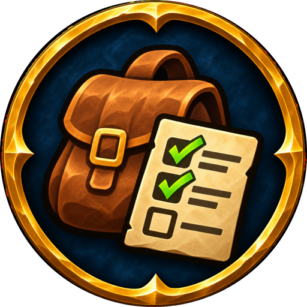

<p align="center"></p>

# Items Collect Tracker

A small, see-through bar for World of Warcraft (made for **WoW Forever**) that counts the items you're
collecting and tells you when you have enough.

- Starts empty: just a faint **+**. Click it and type a name (suggestions show as you type, from your bags,
  items you've seen and every item the client knows), shift-click an item, or drop one from your bags.
- Then set how many to collect (0 = no goal, just count).
- Each item shows its count in big numbers: above, below or on the icon. Font, outline, size and colors are
  yours to pick; the number changes color once the goal is reached, and a sound plays (a game sound, a
  LibSharedMedia one, or your own file).
- Only what you collect after adding an item counts. The tooltip shows how many you collect in an hour and when
  you reach the goal at that pace.
- **Ctrl + left click** takes an item off the bar (the keys and the button can be changed).
- Right click on an item: change its goal, count from 0 again, move it left or right, lock the bars, settings.
- Drag any icon (or the +) to move the bar, its bottom-right corner to resize it. Shift + drag an icon to put it
  in another place, on this bar or another one. No frame and no background unless you want one; the + can
  show only under the mouse.
- Several bars: right-click the + for a new bar, to copy another character's items, or to put the reagents of
  the recipe open in the profession window on the bar (there's a button in that window too).
- Goal reached: the number changes color, the icon flashes, a sound plays; the item can leave the bar.
- A thin progress bar on the icon, if you like.
- With [Syndicator](https://www.curseforge.com/wow/addons/syndicator) the mail and your other characters can count too.
- A button on the minimap (a LibDBIcon one when another addon brought the library): click for the settings,
  right-click to show or hide the bars, drag to move it.
- English and Ukrainian.

The bars and their items are kept per character; the look and the sound are shared by all characters.

## Commands

| Command | |
|---|---|
| `/ic` | settings |
| `/ic add [item]` | add an item (name, ID or link) |
| `/ic recipe` | the reagents of the recipe open in the profession window |
| `/ic bar` | a new bar |
| `/ic lock`, `/ic unlock` | lock or unlock the bars |
| `/ic show`, `/ic hide` | show or hide the bars |
| `/ic reset` | put the bars back in the middle of the screen |
| `/ic minimap` | show or hide the minimap button |

## Your own sounds

Put `.ogg` or `.mp3` files in `World of Warcraft/_forever_/Interface/ItemsCollectTrackerSounds/`, restart the
game, then type the file name in the settings (Goal reached → Your sound file).

## Development

```sh
# link into the Forever client
ln -s "$PWD/ItemsCollectTracker" "/Applications/World of Warcraft/_forever_/Interface/AddOns/ItemsCollectTracker"

# tests (plain Lua, no game needed)
lua tests/run.lua    # text matching, parsing, click combinations
lua tests/load.lua   # loads the addon against a pretend game API and plays a session
```
