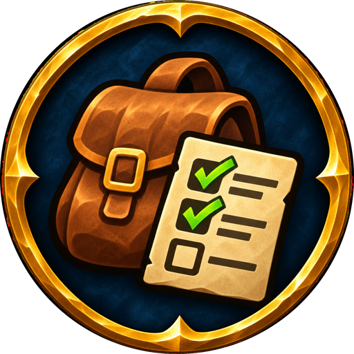

**A see-through bar that counts the items you collect, with a goal for each.**

> **Early development.** Items Collect Tracker is young. If something looks wrong or you miss a feature, please
> tell me in the comments or on [GitHub](https://github.com/v-gachkovsky/items-collect-tracker/issues):
> no report is too small.

Farming cloth, herbs or quest items? Put them on the bar and see at a glance how many you have and how many
you still need. When you have enough, the number changes color and a sound plays.

**Works on every client:** WoW Forever, Classic Era, TBC Anniversary, Mists of Pandaria Classic and Retail.

---

## How it works

- **The bar starts empty**: just a faint **+**. No frame, no background: only the icons and their numbers.
- **Add an item**: click the + and type a few letters. Suggestions show as you type, with icons: items in your
  bags first, then items you've seen, then every item the game knows. Or shift-click an item, or drop one from
  your bags on the +.
- **Set a goal**: how many to collect. 0 just counts.
- **Big, clear numbers** above, below or on the icon. Pick the font, outline, size and colors, and what it shows:
  the count (12), the count with the goal (12/20), or how many are still missing (8).
- **Goal reached**: the number changes color and a sound plays: a game sound, one from LibSharedMedia, or your
  own file. A chat line too, if you like.
- **Ctrl + left click** takes an item off the bar. Pick other keys or another mouse button in the settings.
- **Right click** on an item: change its goal, move it left or right, lock the bar, settings.
- **Drag** any icon or the + to move the bar, its bottom-right corner to resize the icons.
- **Minimap button**: click for the settings, right-click to show or hide the bar.

## Settings (`/ic`)

Items in a row, icon size and spacing, opacity while the mouse is away, a background, the + only under the
mouse, counting the bank, greying out items you don't have, hiding in combat, the language (English or
Ukrainian).

The items on the bar are kept for each character; the look and the sound are shared by all of them.

## Commands

- `/ic`: settings
- `/ic add [item]`: add an item (name, ID or link)
- `/ic lock`, `/ic unlock`: lock or unlock the bar
- `/ic show`, `/ic hide`: show or hide the bar
- `/ic reset`: put the bar back in the middle of the screen
- `/ic minimap`: show or hide the minimap button

## Your own sounds

Put `.ogg` or `.mp3` files in `World of Warcraft/<client>/Interface/ItemsCollectTrackerSounds/`, restart the
game, then type the file name in the settings (Goal reached → Your sound file).
